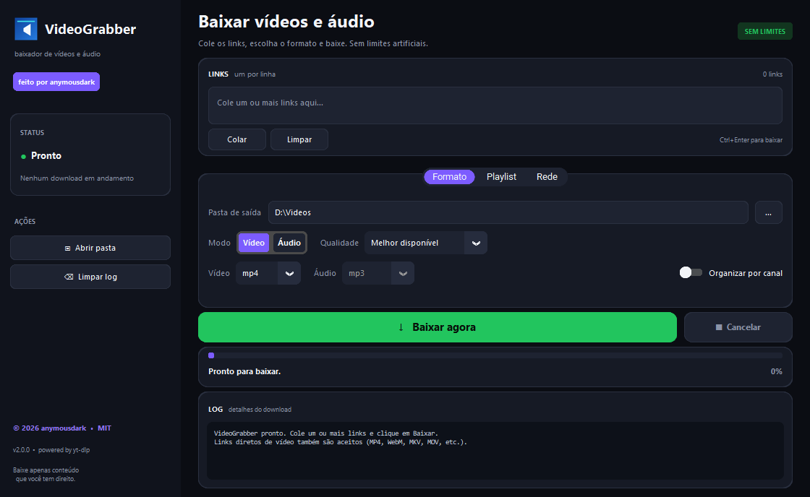

# VideoGrabber 🎬

**Baixe vídeos, playlists e áudio de qualquer site compatível com o [yt-dlp](https://github.com/yt-dlp/yt-dlp).**

> **feito por [anymousdark](https://github.com/anymousdark)**


<p align="center">
  
</p>

---

## ✨ O que o app faz

O VideoGrabber é um **baixador de vídeos e áudio**, com interface gráfica e CLI.
Ele usa o yt-dlp por baixo dos panos, então funciona com **qualquer site que o
yt-dlp suporte** (YouTube, Vimeo, TikTok, Instagram, Twitter/X, Twitch, etc.) e
também com **links diretos** de arquivos de vídeo.

> Este app **não grava a tela**. Ele baixa vídeos/áudio pela internet.

---

## 🚀 Recursos

- 🔗 **Fila com vários links** — cole um link por linha e baixe tudo em sequência
- 🎞 **Vídeo em MP4, MKV ou WebM** na melhor qualidade disponível
- 🎧 **Áudio em MP3, M4A, OPUS, FLAC, WAV ou “melhor”**
- 📺 **Qualidade até 8K+** (Melhor disponível, 4320p, 2160p, 1440p, 1080p, 720p, 480p, 360p, 240p, 144p)
- 📃 **Playlists completas ou por intervalo** (ex.: `1-10,15,20-30`)
- 💬 **Legendas em qualquer idioma** (padrão: `pt,pt-BR,pt-PT,en`)
- 🍪 **Cookies do navegador** (Chrome, Edge, Firefox, Brave, Opera, Vivaldi, Chromium) para acessar conteúdo que você já tem permissão
- ⏭ **SponsorBlock** — marca capítulos de patrocínio/abertura/encerramento
- 🖼 **Thumbnail embutida** no arquivo
- 🗂 **Organização por canal** (opcional)
- 🕘 **Histórico opcional** para não baixar o mesmo vídeo duas vezes
- 🚦 **Limite de velocidade** (KB/s), **proxy** e **fragmentos paralelos**
- 📥 **Links diretos** de MP4, WebM, MKV, MOV, AVI, MPEG, TS, OGV e 3GP
- 📊 **Barra de progresso**, velocidade, ETA, tamanho baixado, log e cancelamento
- 🌙 **Interface escura moderna** com sidebar, abas, switches e cantos arredondados (CustomTkinter)
- 💻 **CLI** para automação e scripts
- 📦 **FFmpeg embutido** no executável (extração de MP3/MP4 sem instalar nada)
- 🆓 **Sem trial, sem marca d'água e sem limite de downloads do app**
- 🧾 **Código aberto (MIT)**

---

## 🔓 Limitações removidas nesta versão

| Antes | Agora |
|-------|-------|
| Um link por vez | Fila com vários links |
| Só legendas PT/EN | Qualquer idioma |
| Só MP4 / MP3 | MP4, MKV, WebM / MP3, M4A, OPUS, FLAC, WAV |
| Playlist inteira apenas | Playlist completa ou intervalo |
| Sem cookies | Cookies do navegador |
| Sem SponsorBlock | SponsorBlock opcional |
| Sem thumbnail | Thumbnail embutida |
| Histórico fixo | Histórico ligado/desligado |
| Sem controle de rede | Limite de velocidade, proxy e fragmentos |
| Sem organização | Organização por canal |
| Tema claro básico | Interface escura moderna |

---

## 📦 Usar o executável

1. Baixe o **`VideoGrabber.exe`** na página de **[Releases](https://github.com/anymousdark/VideoGrabber/releases/latest)**.
2. Execute. Não precisa instalar Python.
3. Cole um ou mais links, escolha a pasta e as opções.
4. Clique em **Baixar**.

> O Windows pode exibir o SmartScreen por ser um executável novo.
> Clique em **Mais informações → Executar assim mesmo**.

---

## 🐍 Rodar pelo código

```bash
git clone https://github.com/anymousdark/VideoGrabber.git
cd VideoGrabber

python -m venv .venv
.venv\Scripts\activate
pip install -r requirements.txt

python video_grabber.py
```

Requisitos: **Python 3.10+** e Windows 10/11 (também roda em Linux/macOS com Python).

---

## 💻 CLI

```bat
python video_grabber.py "https://youtu.be/XXXX" -o "D:\Videos" -q 2160
python video_grabber.py "https://youtu.be/XXXX" --audio --audio-format mp3
python video_grabber.py URL1 URL2 URL3 -o "D:\Videos"
python video_grabber.py "https://site.com/playlist" --playlist --playlist-items "1-10,15"
python video_grabber.py "https://site.com/video" --cookies chrome --sponsorblock
python video_grabber.py "https://site.com/video" --speed-limit 2048 --proxy "http://127.0.0.1:8080"
```

Opções principais:

| Opção | Descrição |
|-------|-----------|
| `-o, --out` | pasta de saída |
| `-q, --quality` | `melhor`, `4320`, `2160`, `1440`, `1080`, `720`, `480`, `360`, `240`, `144` |
| `--video-format` | `mp4`, `mkv`, `webm` |
| `--audio` | extrair áudio |
| `--audio-format` | `mp3`, `m4a`, `opus`, `flac`, `wav`, `melhor` |
| `--playlist` | baixar playlist inteira |
| `--playlist-items` | intervalo, ex.: `1-10,15` |
| `--no-subs` | não baixar legendas |
| `--sub-langs` | idiomas, ex.: `pt,en,es` |
| `--cookies` | `chrome`, `edge`, `firefox`, `brave`, `opera`, `vivaldi`, `chromium` |
| `--sponsorblock` | marcar capítulos do SponsorBlock |
| `--no-thumbnail` | não embutir thumbnail |
| `--no-archive` | não usar histórico |
| `--speed-limit` | limite em KB/s (0 = ilimitado) |
| `--fragments` | fragmentos paralelos |
| `--proxy` | proxy HTTP/SOCKS |
| `--organize` | organizar por canal |

---

## 🔧 Recompilar o executável

```bat
pip install -r requirements.txt
python build_exe.py
```

O script instala as dependências, localiza o FFmpeg, gera `dist\VideoGrabber.exe`
e copia para `release\VideoGrabber.exe`.

---

## 🗂 Estrutura

```
VideoGrabber/
├── video_grabber.py    # motor yt-dlp + CLI
├── app_ui.py           # interface gráfica moderna (CustomTkinter)
├── build_exe.py        # build com PyInstaller + FFmpeg embutido
├── requirements.txt
├── assets/
│   ├── icon.ico
│   ├── icon.png
│   └── screenshot.png
├── release/            # saída local do build (o .exe fica nas Releases)
├── LICENSE
└── README.md
```

---

## ⚖️ Aviso legal

Baixe apenas conteúdo que você tem direito de baixar (seus próprios vídeos,
conteúdo de domínio público, Creative Commons ou com autorização). O app não
remove DRM nem contorna pagamentos; respeite os termos de uso de cada site.

---

## 📄 Licença

MIT — use, modifique, distribua e venda. Veja [LICENSE](LICENSE).

**Créditos:** feito por **anymousdark**.

---

<p align="center">🎬 VideoGrabber — sem trial, sem marca d'água, sem limites artificiais.</p>
